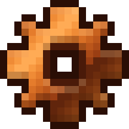

<p align="center">
  
</p>

<p align="center">
  <a href="https://github.com/sysv86/rustmpeg-next/blob/main/Cargo.toml#L15"></a>
  <a href="https://crates.io/crates/rustmpeg"></a>
  <a href="https://github.com/sysv86/rustmpeg-next/releases"></a>
</p>

- <a href="docs/"></a>&nbsp;&nbsp;[Docs](docs/) — architecture, codecs, and status
- <a href="docs/benchmarks/BENCHMARK.md"></a>&nbsp;&nbsp;[Benchmarks](docs/benchmarks/BENCHMARK.md) — measured BD-rate and speed
- <a href="docs/configs/CONFIG.md"></a>&nbsp;&nbsp;[Config](docs/configs/CONFIG.md) — CLI, options, and offline build
- <a href="docs/faq/FAQ.md"></a>&nbsp;&nbsp;[FAQ](docs/faq/FAQ.md) — common build and codec questions

> **Status: active development, pre-alpha.** Not ready for production: APIs,
> file formats, and encoded streams change without notice.

A Rust-only multimedia framework built from the standards, not ported from
FFmpeg: demux, decode, filter, encode, mux, and transport. Pre-alpha.

## Try it

```sh
cargo build --release --workspace
cargo run -p rustmpeg-cli -- version
cargo run -p rustmpeg-video --example vvc_dump -- 64 64 26 3 /tmp/out \
    --bit-depth 8 --chroma-format 420
cargo run -p rustmpeg-video --example vvc_decode -- /tmp/out.vvc /tmp/out.yuv
```

Nightly is pinned in `rust-toolchain.toml` (`std::simd`). More commands:
[docs/configs/CONFIG.md](docs/configs/CONFIG.md).

## Support

| Area | Implemented | Status |
| :-- | :-- | :-- |
| Containers | Matroska/WebM, ISOBMFF/CMAF | demux + mux |
| Video | H.266/VVC (intra subset + multi-tool P), AV2 (experimental), APV intra | partial |
| Audio | Opus, FLAC, LPCM, LC3 | partial |
| Image | JPEG XL (`JxlDecoder` + `JxlEncoder`), OpenEXR (`ExrDecoder` + `ExrEncoder`), `moxcms` | implemented (v1/v2) |
| Transport | — | planned |
| GPU | Vulkan Compute, opt-in, bit-exact vs CPU | partial |

## Status

Pre-alpha. Self-reported workspace completion is in the footer and in
[`docs/status.json`](docs/status.json); conformance is claimed only where an
external oracle was run ([VVC status](docs/vvc/STATUS.md)).

## Releases

A `v<version>` tag or a manual `Release` workflow run verifies the tree
(`cargo fmt`, `clippy`, tests, license audit), builds the release examples, and
publishes a GitHub Release with the source archive, the example binaries, and
their checksums. Crates are published in dependency order only when the
`CARGO_REGISTRY_TOKEN` repository secret is configured; otherwise the step
records the skip in the run summary.

## License

Apache-2.0. The VVC module derives from VTM 24.0 (BSD-3-Clause), the AV2
conformance data from dav2d (BSD-2-Clause), and the OpenEXR module from OpenEXR
3.5.2 `OpenEXRCore` (BSD-3-Clause); see [`THIRD_PARTY.md`](THIRD_PARTY.md) and
[`NOTICE`](NOTICE).

<p align="center"><sub><!-- STATS:START -->Rust lines: 166,403 · workspace completion: 63% · unsafe: 0 · source tokens: ~1,582,400 (chars/4)<!-- STATS:END --></sub></p>

